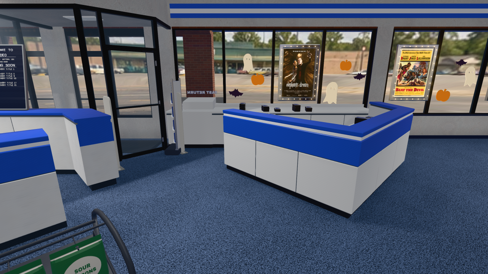

# Entrance and returns check verification (#387)

Verified on 2026-10-12 against dev revision
`bf60a285a032b6fb1c215e86387208cb038e3535` using Node 22.18.0.
The tracked application source and model were unchanged during verification.

## Existing repairs

Commit `05bc36ec14d8e2e6c90a56b801fa3b1cf672ddbb` already contains
the repairs requested by #387:

- `src/exit-return-layout.ts` explicitly imports `store-layout.ts` and
  `storefront-window-layout.ts`, allowing Node's TypeScript test runner to resolve them.
- `tests/exit-return-model.test.ts` checks the seven named material roles,
  including the through-window metal insert, with one mesh per material.
  The triangle and file-size limits remain below 8,000 and 400,000 bytes.

The exported counter measures seven meshes, seven material roles, 4,688 triangles,
and 230,632 bytes. The model test confirms its triangle count against the stored
metrics, alongside bounds, worktop height, backsplash clearance and valid attributes.
No additional application or model change was required.

## Verification

`npm run check` completed with exit status 0: the production build succeeded
and the Node test runner reported 1,228 passes, zero failures, cancellations or skips.
This includes the entrance layout, storefront glazing and returns model tests.

The screenshot below was captured from the verified source in a tree without
user asset overrides, at high quality after the settle frame. The capture reached
its walking checkpoint and used hardware WebGL. It documents the returns counter,
its interior worktop and the receiver at the storefront window.

No live service restart or release was required for this evidence-only change.
